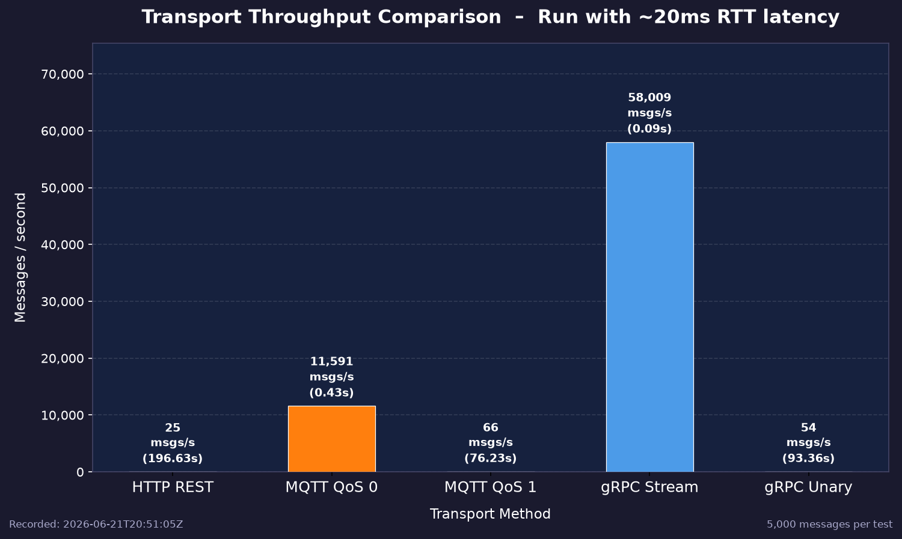
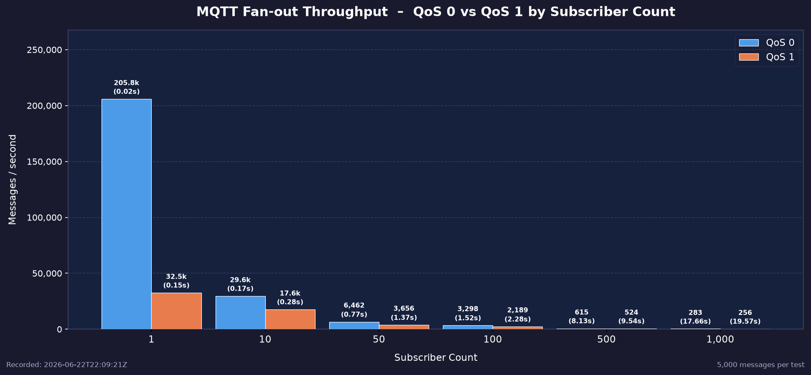
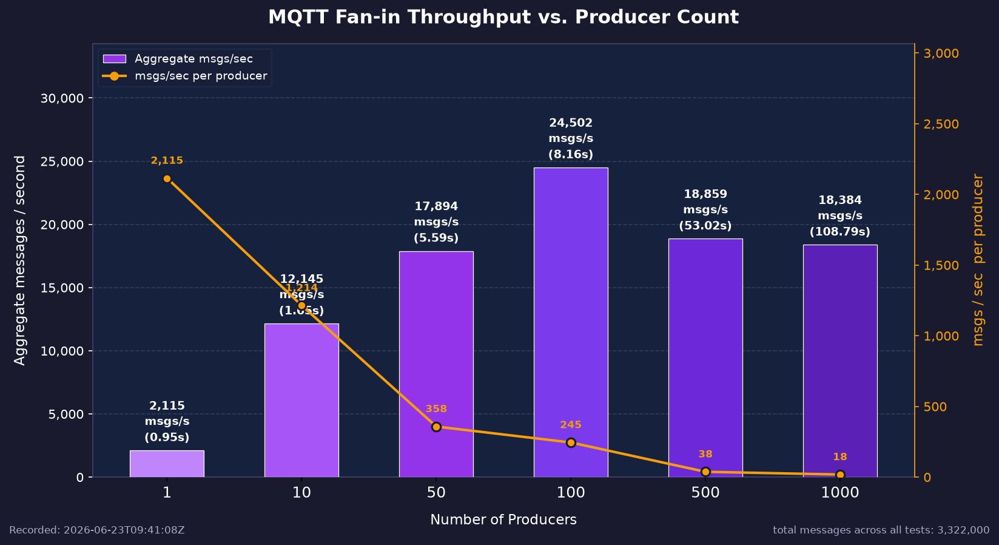

# Aufgabe 1

## Funktional: Registrierung, kritischer Messwert und Dashboard-Status

**Ziel:**
Es wird geprüft, ob die Leitstelle im deployten Docker-Compose-System über die selbst implementierte
HTTP/REST-Schnittstelle einen Sensor und einen Actor registriert, einen kritischen Wasserstand annimmt und daraus im
verteilten Systemzustand einen `WaterLevelAlert` ableitet. Zusätzlich wird geprüft, ob `/map` weiterhin renderbares HTML
für das Dashboard liefert.

**Bewertung:** `PASS`

**Versionsstand:** Commit `efe762d2`

### Setup

**Container:** `world-simulation`, `control-center`, `sensor-*`, `actor-*` aus `docker-compose.yaml`.

**Testdaten:** Der Go-Test erzeugt eindeutige IDs für einen zusätzlichen Sensor vom Typ `water_level`, einen
zusätzlichen
Actor vom Typ `rescue_vehicle` und sendet einen Messwert `95.0` an Position `(3,3)`. Der Schwellwert für `water_level`
liegt bei `> 80`, daher muss ein Vorfall entstehen.

**Automatisierter Test:** `tests/aufgabe1/aufgabe1_integration_test.go`, Testfunktion
`TestRegistrationCriticalReadingAndDashboard`.

### Durchführung

Aus dem Repository-Wurzelverzeichnis:

```bash
docker compose up -d --build
docker run --rm \
  --network vs-praktikum_default \
  -v "$PWD/tests/aufgabe1:/tests" \
  -w /tests \
  -e CONTROL_CENTER_URL=http://control-center:8080 \
  golang:1.26.2-alpine \
  go test -v -run TestRegistrationCriticalReadingAndDashboard .
```

### Ergebnisse
#### Tatsächliches Ergebnis

Der Test wurde im Docker-Netz `vs-praktikum_default` ausgeführt und war erfolgreich:

```text
=== RUN   TestRegistrationCriticalReadingAndDashboard
    aufgabe1_integration_test.go:97: functional result: registered_sensor=it-water-1782192902617889721 registered_actor=it-actor-1782192902617890596 critical_value=95.0 incident=WaterLevelAlert
    aufgabe1_integration_test.go:98: status summary: sensors=9 actors=5 readings=4397 incidents=5
    aufgabe1_integration_test.go:99: dashboard result: content_type="text/html; charset=utf-8" bytes=292610
--- PASS: TestRegistrationCriticalReadingAndDashboard (0.06s)
PASS
ok  	aufgabe1tests	0.063s
```

## Nicht-funktional: Verfügbarkeit und Antwortzeit des Status-Endpunkts

**Ziel:** Es wird gemessen, ob die Leitstelle ihren Gesamtzustand unter wiederholten Client-/Dashboard-Abfragen stabil
und schnell
ausliefert. Die geprüften Qualitätsmerkmale sind Verfügbarkeit und Antwortzeit.

**Bewertung:** `PASS`

**Versionsstand:** Commit `efe762d2`

### Setup

**Container:** `world-simulation`, `control-center`, `sensor-*`, `actor-*` aus `docker-compose.yaml`.

**Messkriterien:** 200 sequenzielle `GET /status`-Anfragen, 0 HTTP-/Transportfehler, alle Antworten HTTP `200`,
p95-Antwortzeit unter `200 ms`.

**Automatisierter Test:** `tests/aufgabe1/aufgabe1_integration_test.go`, Testfunktion
`TestStatusEndpointAvailabilityAndLatency`.

### Durchführung

Aus dem Repository-Wurzelverzeichnis:

```bash
docker compose up -d --build
docker run --rm \
  --network vs-praktikum_default \
  -v "$PWD/tests/aufgabe1:/tests" \
  -w /tests \
  -e CONTROL_CENTER_URL=http://control-center:8080 \
  golang:1.26.2-alpine \
  go test -v -run TestStatusEndpointAvailabilityAndLatency .
```

### Ergebnisse

#### Erwartetes Ergebnis

Der Go-Test endet mit `PASS`. Die Ausgabe enthält `requests=200`, `status_counts=map[200:200]` und Latenzstatistiken mit
`p95_ms < 200.00`.

#### Tatsächliches Ergebnis

Der Test wurde im Docker-Netz `vs-praktikum_default` ausgeführt und war erfolgreich:

```text
=== RUN   TestStatusEndpointAvailabilityAndLatency
    aufgabe1_integration_test.go:144: non-functional result: requests=200 status_counts=map[200:200]
    aufgabe1_integration_test.go:145: latency statistics: min_ms=6.02 avg_ms=6.69 p50_ms=6.42 p95_ms=7.75 max_ms=12.79
--- PASS: TestStatusEndpointAvailabilityAndLatency (1.35s)
PASS
ok  	aufgabe1tests	1.354s
```


# Aufgabe 2
## Funktional: Einsatzzuweisung via gRPC-Streaming für WaterLevelAlert
**Ziel:**
Es wird geprüft, ob die Leitstelle bei einem kritischen Wasserstand einen Incident erzeugt und diesen per RPC/gRPC-Missionsfluss korrekt an einen passenden Fahrzeugtyp zuweist. Die Zuordnung muss für `water_level_alert` auf `water_vehicle` erfolgen und der Missionszustand muss über den Stream bis `done` fortschreiten.

**Bewertung:** `PASS`

**Versionsstand:** Commit `efe762d2`

### Setup
* `world-simulation`, `control-center`, `sensor-*`, `actor-*` aus `docker-compose.yaml`
* Test gegen `CONTROL_CENTER_URL` (Default `http://control-center:8080`)
* automatisierter Go-Test `tests/aufgabe2/aufgabe2_integration_test.go`, Testfunktion `TestAssignWaterIncidentMissionViaGRPC`
* Testdaten: eindeutig registrierter `water_level`-Sensor auf `(1,1)`, Reading `95` (kritisch > 80), Incident-ID-Schema `<sensor-id>-1`.

### Durchführung
Repository-Wurzel:
```shell
make docker-compose-up-build
```
```shell
docker run --rm --network vs-praktikum_default -v "$PWD/tests/aufgabe2:/tests" -w /tests -e CONTROL_CENTER_URL=http://control-center:8080 golang:1.26.2-alpine go test -v -run TestAssignWaterIncidentMissionViaGRPC .
```

### Ergebnisse
#### Erwartetes Ergebnis
Der Go-Test endet mit `PASS`. `POST /register/sensor` und `POST /reading` liefern HTTP `204`. Der Incident ist in `GET /status` vorhanden. `POST /incidents/:incidentID/mission` liefert HTTP `200` und einen NDJSON-Stream mit Missions-Updates, der mindestens `assigned` und `busy` enthält und mit `done` endet. Das finale Update hat `actor_type=water_vehicle`.

#### Tatsächliches Ergebnis
```
=== RUN   TestAssignWaterIncidentMissionViaGRPC
--- PASS: TestAssignWaterIncidentMissionViaGRPC (0.34s)
PASS
ok  	aufgabe2tests	0.345s
```

## Nicht-funktional: Latenz und Zuverlässigkeit des Missions-Streams
Der Test ist aufgrund der Migration von gRPC Streams zu MQTT nicht mehr anwendbar.

# Aufgabe 3
## Funktional: MQTT-Nachrichtenfluss für Sensordaten und Actor-Status
**Ziel:**
Es wird geprüft, ob die für Aufgabe 3 eingeführte MQTT-Kommunikation im deployten Docker-Compose-System funktional
arbeitet. Der Test verbindet sich als echter MQTT-Client mit Mosquitto, abonniert die Wildcard-Topics der Anwendung,
publiziert eine kritische Sensorlesung sowie Actor-Status und Actor-Telemetrie und prüft anschließend, ob die
Leitstelle diese Nachrichten in `/status` übernommen hat. Damit werden Broker-Zustellung, Topic-Schema, JSON-Payloads
und die reaktive Verarbeitung im `control-center` gemeinsam getestet.

**Bewertung:** `PASS`

**Versionsstand:** Commit `acdc92f`

### Setup
**Container:** `mqtt-broker`, `control-center`, `world-simulation`, `sensor-*`, `actor-*` aus `docker-compose.yaml`.

**Konfiguration:** Der Test nutzt `CONTROL_CENTER_URL` (Default `http://control-center:8080`) und `MQTT_BROKER_URL`
oder alternativ `MQTT_BROKER_HOST`/`MQTT_BROKER_PORT` (Default `tcp://mqtt-broker:1883`).

**Testdaten:** Der Go-Test registriert einen eindeutigen `water_level`-Sensor und einen eindeutigen `water_vehicle`
ueber die HTTP-Schnittstelle, publiziert danach eine kritische MQTT-Sensorlesung mit Wert `95.0` auf
`tiles/<x>/<y>/readings/water_level`, einen Actor-Status `on_a_mission` auf `actors/<actor-id>/status` und eine
Actor-Telemetrie auf `actors/<actor-id>/telemetry`.

**Automatisierter Test:** `tests/aufgabe3/aufgabe3_mqtt_integration_test.go`, Testfunktion
`TestMQTTSensorAndActorMessagesReachControlCenter`.

### Durchführung
Aus dem Repository-Wurzelverzeichnis:

```bash
docker compose up -d --build
docker run --rm \
  --network vs-praktikum_default \
  -v "$PWD/tests/aufgabe3:/tests" \
  -w /tests \
  -e CONTROL_CENTER_URL=http://control-center:8080 \
  -e MQTT_BROKER_URL=tcp://mqtt-broker:1883 \
  golang:1.26.2-alpine \
  go test -v -run TestMQTTSensorAndActorMessagesReachControlCenter .
```

### Ergebnisse
#### Erwartetes Ergebnis
Der Go-Test endet mit `PASS`. Die MQTT-Subscription empfängt die publizierten Nachrichten auf den erwarteten Topics.
`GET /status` enthaelt die kritische Sensorlesung, einen `WaterLevelAlert` (`incident=1`) für diesen Sensor sowie den
per MQTT aktualisierten Actor mit Status `on_a_mission` und der publizierten Position.


#### Tatsächliches Ergebnis
Der Test wurde im Docker-Netz `vs-praktikum_default` ausgefuehrt und war erfolgreich:

```text
=== RUN   TestMQTTSensorAndActorMessagesReachControlCenter
    aufgabe3_mqtt_integration_test.go:164: functional result: mqtt_broker=tcp://mqtt-broker:1883 reading_topic=tiles/6/6/readings/water_level status_topic=actors/it3-actor-1782148678786595540/status telemetry_topic=actors/it3-actor-1782148678786595540/telemetry
    aufgabe3_mqtt_integration_test.go:165: status summary: sensors=8 actors=4 readings=1061 incidents=5
    aufgabe3_mqtt_integration_test.go:166: verified mqtt control-center projection: sensor_id=it3-water-1782148678786595540 value=95.0 incident=WaterLevelAlert actor_id=it3-actor-1782148678786595540 state=on_a_mission position=(6,6)
--- PASS: TestMQTTSensorAndActorMessagesReachControlCenter (0.05s)
PASS
ok  	aufgabe3tests	0.053s
```

#### Artefakte
Automatisierter Test: `tests/aufgabe3/aufgabe3_mqtt_integration_test.go`.


## Nicht-funktional: Vergleich Durchsatzmessung der Transportschichten

**Ziel:** Es wird gemessen, wie der Durchsatz einer Nutzlast durch die eingesetzte Transportschicht beeinflusst wird. Dazu wird die Nutzlast über HTTP, gRPC (unary + stream) sowie MQTT (QoS 0 & QoS 1) versendet und der Durchsatz auf Empfängerseite gemessen. Der Test simuliert einen Knoten im Netzwerk, welcher so schnell wie möglich eine Nutzlast produziert, und diese an einen Konsumenten abgeben möchte. Das geprüfte Qualitätsmerkmal ist der Durchsatz.

**Bewertung:** `PASS`

**Versionsstand:** Commit `2760b922`

### Setup

**Container:** MQTT Runtime

**Konfiguration:** Keine

**Testdaten:** Über alle Transportschichten hinweg wurden folgende Nutzdaten versendet und auf Empfängerseite deserialisiert.

```go
type wirePayload struct {
	ActorID   string `json:"actor_id"`
	PosX      int32  `json:"pos_x"`
	PosY      int32  `json:"pos_y"`
	Timestamp uint64 `json:"timestamp"`
	SentAt    uint64 `json:"sent_at"`
}
```

### Durchführung

Im Test wurden sequenziell 100 000 Nachrichtenpakete mit der angegebenen Nutzlast über die verschiedenen Transportprotokolle verschickt. Dabei wurde gemessen, wie viele Nachrichtenpakete pro Sekunde den Empfänger erreichen.

### Ergebnisse

#### Erwartetes Ergebnis

Es wird erwartet, dass der gRPC-Stream den höchsten Durchsatz erzielt. HTTP und unary gRPC sollten ähnliche Werte liefern, wobei gRPC aufgrund seines Binärformats einen Vorteil gegenüber HTTP haben dürfte. MQTT mit QoS 0 sollte deutlich höheren Durchsatz aufweisen als MQTT mit QoS 1. In einem echten Netzwerk mit Latenz > 0 ms sollten alle Protokolle deutlich reduzierten Durchsatz aufweisen. gRPC streaming und MQTT QoS 0 sollten weiterhin beim Durchsatz dominieren. Bei allen Protokollen mit Request / Reply sollte bei Latenzen > 0 die Latenz den Durchsatz extrem stark beeinflussen.

#### Tatsächliches Ergebnis

Das Ergebnis ist in den folgenden Grafiken visualisiert. Die erste Grafik zeigt den Durchsatz auf einem lokalen Rechner, wo Produzent und Konsument auf derselben Maschine laufen. Die zweite Grafik zeigt den Durchsatz bei 2 Rechnern, die über ein echtes Netzwerk mit einer durchschnittlichen RTT von rund 20ms verbunden sind. Es ist klar zu erkennen, dass die asynchronen Verfahren ein Vielfaches vom Durchsatz aufweisen. Es ist auch zu erkennen das in echten NEtzwerken der Durchsatz physikalisch auf `Durchsatz [Nachrichten / Sekunde] = 1 Sekunde / RTT` beschraenkt ist.




## Nicht-funktional: MQTT Fan-out Skalierung

**Ziel:** Es wird gemessen, wie der MQTT-Broker unter zunehmendem Fan-out skaliert. Dazu wird ein einzelner Publisher mit fixer Senderate betrieben, während die Anzahl der Subscriber schrittweise erhöht wird. Der Durchsatz wird pro Subscriber gemessen — von dem Zeitpunkt der ersten gesendeten Nachricht bis zum Empfang der letzten Nachricht bei jedem Subscriber. Der Test simuliert ein Publish/Subscribe-Szenario, in dem viele Konsumenten denselben Datenstrom empfangen möchten. Das geprüfte Qualitätsmerkmal ist die Fan-out-Skalierbarkeit des Brokers.

**Bewertung:** `PASS`

**Versionsstand:** Commit `3afde28f`

### Setup

**Container:** MQTT Runtime

**Konfiguration:** Keine

**Testdaten:** Über alle Runs hinweg wurden folgende Nutzdaten versendet und auf Empfängerseite deserialisiert. Das Feld `SentAt` enthält den Nanosekunden-Timestamp der *ersten* gesendeten Nachricht eines Runs und ist für alle Nachrichten eines Runs konstant, sodass alle Subscriber dieselbe Startzeit verwenden.

```go
type fanoutWirePayload struct {
    ActorID   string `json:"actor_id"`
    PosX      int32  `json:"pos_x"`
    PosY      int32  `json:"pos_y"`
    Timestamp uint64 `json:"timestamp"`
    SentAt    uint64 `json:"sent_at"`
}
```

### Durchführung

Im Test wurden sequenziell 5000 Nachrichtenpakete mit der angegebenen Nutzlast über MQTT (QoS 0) an einen Broker versendet. Die Anzahl der aktiven Subscriber wurde dabei schrittweise auf `N ∈ {1, 10, 50, 100, 500}` erhöht. Jeder Subscriber ist ein unabhängiger MQTT-Client mit eindeutiger Client-ID, der dieselbe Topic-Wildcard abonniert. Die Messung startet mit dem Timestamp der ersten gesendeten Nachricht (`SentAt`) und endet, wenn der jeweilige Subscriber die letzte seiner 5000 Nachrichten empfangen hat. Als Gesamtergebnis pro Run wird die Zeit des *langsamsten* Subscribers gewertet, da der Broker erst dann alle Nachrichten vollständig ausgeliefert hat.

### Ergebnisse

#### Erwartetes Ergebnis

Es wird erwartet, dass bei niedrigen Subscriber-Zahlen (N = 1–10) der Durchsatz nahezu konstant bleibt, da der Broker die Nachrichten parallel ausliefern kann. Ab einem bestimmten Schwellenwert — erwartet zwischen N = 50 und N = 100 — sollte der Broker beginnen, die Auslieferung zu serialisieren, wodurch der Durchsatz pro Subscriber merklich sinkt und die Finish-Zeiten der einzelnen Subscriber stärker auseinanderdriften. Bei N = 500 wird ein deutlich erhöhter Spread zwischen schnellstem und langsamstem Subscriber erwartet.

#### Tatsächliches Ergebnis

Das Ergebnis ist in den folgenden Grafiken visualisiert. Die Grafik zeigt den Gesamtdurchsatz (Nachrichten/Sekunde) in Abhängigkeit der Subscriber-Anzahl.




## Nicht-funktional: MQTT Fan-in Skalierung

