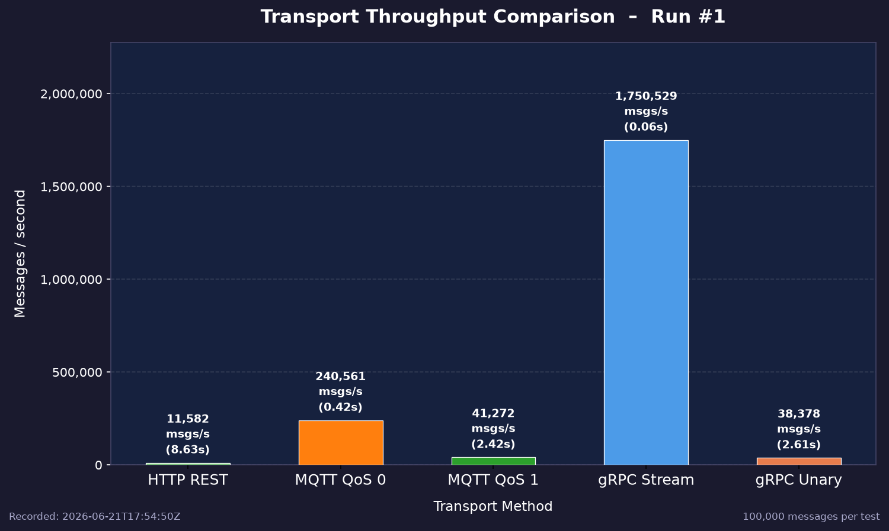

# Aufgabe X
## Funktional: [Titel]
**Ziel:**

**Bewertung:** `PASS`, `FAIL` oder `BLOCKED`

**Versionsstand:** Commit `#`

### Setup
Container, Konfiguration, Testdaten

### Durchführung


### Ergebnisse
#### Erwartetes Ergebnis


#### Tatsächliches Ergebnis


#### Artefakte
Logs, Screenshots oder Reports


## Nicht-funktional: Vergleich Durchsatzmessung der Transportschichten

**Ziel:** Es wird gemessen, wie der Durchsatz einer Nutzlast durch die eingesetzte Transportschicht beeinflusst wird. Dazu wird die Nutzlast über HTTP, gRPC (unary + stream) sowie MQTT (QoS 0 & QoS 1) versendet und der Durchsatz auf Empfängerseite gemessen. Das geprüfte Qualitätsmerkmal ist der Durchsatz.

**Bewertung:** `PASS`

**Versionsstand:** Commit `2760b922`

### Setup

**Container:** MQTT Runtime

**Konfiguration:** Keine

**Testdaten:** Über alle Transportschichten hinweg wurden folgende Nutzdaten versendet und auf Empfängerseite deserialisiert.

```go
type wirePayload struct {
	ActorID   string `json:"actor_id"`
	PosX      int32  `json:"pos_x"`
	PosY      int32  `json:"pos_y"`
	Timestamp uint64 `json:"timestamp"`
	SentAt    uint64 `json:"sent_at"`
}
```

### Durchführung

Im Test wurden sequentiell 100.000 Nachrichtenpakete mit der angegebenen Nutzlast über die verschiedenen Transportprotokolle verschickt. Dabei wurde gemessen, wie viele Nachrichtenpakete pro Sekunde den Empfänger erreichen.

### Ergebnisse

#### Erwartetes Ergebnis

Es wird erwartet, dass der gRPC-Stream den höchsten Durchsatz erzielt. HTTP und unary gRPC sollten ähnliche Werte liefern, wobei gRPC aufgrund seines Binärformats einen Vorteil gegenüber HTTP haben dürfte. MQTT mit QoS 0 sollte deutlich höheren Durchsatz aufweisen als MQTT mit QoS 1.

#### Tatsächliches Ergebnis

Das Ergebnis ist in der folgenden Datei visualisiert.



#### Artefakte

Logs, Screenshots oder Reports
