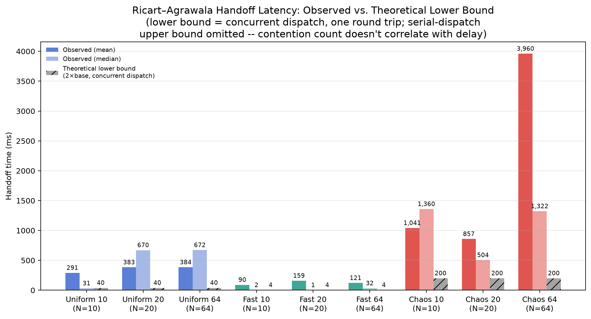

# Aufgabe 4
## Funktional: Ricart-Agrawala Mutual Exclusion
**Ziel:** Automatisiert nachweisen, dass mehrere Teilnehmer den Zugriff auf dieselbe kritische Ressource per Ricart-Agrawala koordinieren. Geprüft werden Request-/Reply-Fluss, Eintritt und Austritt aus der Critical Section, gegenseitiger Ausschluss, Priorisierung nach `(logical_clock, actor_id)` und die Beobachtbarkeit über `GET /ricart/status`.

**Bewertung:** `PASS`

**Versionsstand:** Commit `8b85523`

### Setup
Container, Konfiguration, Testdaten:

* Docker-Compose-Stack `vs-praktikum` mit `control-center`, `mqtt-broker` und `world-simulation`.
* Automatisierter Go-Test: `tests/aufgabe4/aufgabe4_ricart_integration_test.go`, Testfunktion `TestRicartAgrawalaMutualExclusionAndLogicalClocks`.
* Der Test erzeugt drei temporäre Ricart-Teilnehmer mit eindeutigen Actor-IDs und einer eindeutigen Ressource `charging-station:8:10:<run-id>`.
* Kommunikation erfolgt ausschließlich über die Ricart-MQTT-Topics `ricart/presence/+`, `ricart/request`, `ricart/reply/<actor-id>`, `ricart/cs/enter` und `ricart/cs/exit`.
* Beobachtung und Bewertung erfolgen über `GET /ricart/status` am Control-Center.

### Durchführung
```shell
make aufgabe4-functional
```

Der Test wartet auf `/health`, verbindet drei MQTT-Teilnehmer, meldet sie per Presence online, startet konkurrierende Critical-Section-Requests und liest anschließend `/ricart/status`, bis alle erwarteten Events vorhanden sind.

Geprüfte Kriterien:

* Für jeden Teilnehmer existieren `request`, `cs_enter` und `cs_exit` in dieser Reihenfolge.
* Alle `request`, `reply` und `cs_enter` Events enthalten sinnvolle `logical_clock` Werte.
* Jeder `reply` enthält einen `peer_id`.
* Es gibt keine überlappenden Zeitintervalle zwischen `cs_enter` und `cs_exit` zweier Teilnehmer derselben Ressource.
* Die Reihenfolge der `cs_enter` Events folgt der Ricart-Agrawala-Priorität `(logical_clock, actor_id)`.
* Die Ressource ist nach allen `cs_exit` Events wieder `free`, hat keinen `holder_actor_id` und setzt `last_logical_clock`.

### Ergebnisse
#### Erwartetes Ergebnis
Der Go-Test endet mit `PASS`. Die Ausgabe enthält eine Funktionszusammenfassung mit drei Requests, mindestens sechs Replies, drei `cs_enter` Events und drei `cs_exit` Events für die Testressource. `/ricart/status` enthält die beteiligten Participants, die Ressource und die Eventliste mit `logical_clock`.


#### Tatsächliches Ergebnis
```text
=== RUN   TestRicartAgrawalaMutualExclusionAndLogicalClocks
    aufgabe4_ricart_integration_test.go:179: functional result: resource=charging-station:8:10:it4-1783252822913771110 actors=[it4-1783252822913771110-actor-a it4-1783252822913771110-actor-b it4-1783252822913771110-actor-c] requests=3 replies=6 cs_enter=3 cs_exit=3
    aufgabe4_ricart_integration_test.go:180: status summary: participants=6 resources=1 ricart_events=27 last_logical_clock=12
--- PASS: TestRicartAgrawalaMutualExclusionAndLogicalClocks (0.77s)
PASS
ok  	aufgabe4tests	0.771s
```

## Nicht-funktional: Handoff-Latenz des Ricart-Agrawala-Protokolls
**Ziel:**
Es wird gemessen, wie schnell die kritische Section zwischen mehreren Ricart-Agrawala-Teilnehmern übergeben wird. Geprüft wird die Handoff-Latenz `sync_delay_ms` unter unterschiedlichen Netzszenarien sowie der Vergleich der beobachteten Werte mit den theoretischen Schranken des Protokolls.

**Bewertung:** `PASS`

**Versionsstand:** Commit `e1912f3`

### Setup
* Docker-Compose-Stack `performance/ricart-agrawala/docker-compose.yaml` mit `mqtt-broker`, `toxiproxy`, `proxy-setup`, `collector` und den `node-*`-Containern.
* Der Collector schreibt die Messwerte nach `performance/ricart-agrawala/metrics/` und erfasst pro Handoff `sync_delay_ms`, `recv_delay_ms` und `k`.
* Die Messreihen umfassen die Szenarien `uniform`, `fast` und `chaos` jeweils mit 10, 20 und 64 Knoten.
* Alle Knoten konkurrieren um dieselbe Ressource `charging-station` und publizieren die Critical-Section-Ereignisse über `cs/events`.
* Tests werden durch manuelles anpassen der Docker Compose durchgefuehrt

### Durchführung
Die Performance-Messung wurde gegen den Docker-Compose-Stack im Ordner `performance/ricart-agrawala` ausgeführt. Die Rohdaten wurden als CSV-Dateien im Unterordner `metrics/` gespeichert und anschließend mit den Plot-Skripten visualisiert.

### Ergebnisse
#### Erwartetes Ergebnis
Es wird erwartet, dass das Szenario `chaos` die höchsten Handoff-Latenzen zeigt, `uniform` im Mittelfeld liegt und `fast` die niedrigsten Werte liefert. Zusätzlich sollten die Messwerte im groben Rahmen der theoretischen Schranken liegen, die sich aus einer vollständig parallelen bzw. vollständig seriellen Ausführung der Nachrichtenübertragung ergeben.

#### Tatsächliches Ergebnis

Die Messungen zeigen eine deutlich höhere Streuung im Szenario `chaos` sowie klar niedrigere Latenzen in `fast` und `uniform`. Die Verteilungen liegen nicht nur unter der Worst-Case-Schranke, sondern machen sichtbar, dass die Handoff-Latenz stark von Szenario und Contention abhängt.

Alle Knoten im Test versuchen aggressiv auf eine limitierte Ressource zuzugreifen. Ziel ist zu verifizieren, ob das System eine hohe Last an Synchronisierungsnachrichten verwalten kann.

Die **logische Nachrichtenkomplexität** des zugrunde liegenden Algorithmus (Ricart-Agrawala-artig) liegt bei `2(N−1)` Nachrichten pro einzelnem Critical-Section-Request eines Knotens (`N−1` REQUESTs + `N−1` REPLYs). Diese Größe ist getrennt zu betrachten von der **Gesamtzahl der MQTT-Pakete**, die weiter unten für den Worst Case gemessen wird, in dem alle `N` Knoten gleichzeitig einen Request stellen — dort addiert sich zusätzlich der CS-ENTER/EXIT-Verkehr sowie der QoS-Protokoll-Overhead (PUBREC/PUBREL/PUBCOMP bzw. PUBACK).

In diesem Worst-Case-Szenario dominieren `REQUEST` und `REPLY` den Datenverkehr: Bei N=64 machen beide Typen zusammen rund **67 %** der insgesamt übertragenen MQTT-Pakete aus (32.256 von 48.384 Paketen), `CS ENTER`/`CS EXIT` zusammen die restlichen ca. 33 %.

Zu erkennen ist, dass die Synchronisationslatenzen mit zunehmender Teilnehmerzahl wachsen. Jedoch ist dies im Test nicht so eindeutig wie zuerst vermutet: `Uniform 20` und `Uniform 64` weisen nahezu identische `mean`- und `median`-Werte auf. `Chaos 20` und `Chaos 64` zeigen dagegen ein ganz anderes Bild — hier ist klar zu erkennen, dass der Synchronisierungsaufwand bei unberechenbarer Latenz und Jitter mit der Teilnehmeranzahl deutlich zunimmt.

| Type | Publishes | Deliveries | QoS | Packets/delivery |
|---|---|---|---|---|
| REQUEST  | `N`        | `N(N−1)` | 2 | 4 |
| REPLY    | `N(N−1)`   | `N(N−1)` | 2 | 4 |
| CS ENTER | `N`        | `N(N−1)` | 1 | 2 |
| CS EXIT  | `N`        | `N(N−1)` | 1 | 2 |

**Total MQTT packets = `12 × N × (N−1)`**

- `REQUEST` und `ENTER/EXIT` werden per MQTT broadcastet (1 Publish → N−1 Deliveries).
- `REPLY` ist Point-to-Point (1 Publish → 1 Delivery), aber mit `N(N−1)` Reply-Nachrichten insgesamt, da im Worst Case jeder Knoten jedem anderen genau einmal antwortet.
- QoS 2 kostet 4 MQTT-Pakete pro Delivery (`PUBLISH`, `PUBREC`, `PUBREL`, `PUBCOMP`); QoS 1 kostet 2 (`PUBLISH`, `PUBACK`).
- Alle Tabellen unten gehen vom **Worst Case** aus, dass alle `N` Knoten gleichzeitig einen CS-Request stellen — daher `N(N−1)` statt `N−1` Deliveries pro Nachrichtentyp.

---

## N = 10

| Type | Publishes | Deliveries | Packets |
|---|---|---|---|
| REQUEST  | 10 | 90 | 360 |
| REPLY    | 90 | 90 | 360 |
| CS ENTER | 10 | 90 | 180 |
| CS EXIT  | 10 | 90 | 180 |
| **Total** |  |  | **1.080** |

## N = 20

| Type | Publishes | Deliveries | Packets |
|---|---|---|---|
| REQUEST  | 20  | 380 | 1.520 |
| REPLY    | 380 | 380 | 1.520 |
| CS ENTER | 20  | 380 | 760 |
| CS EXIT  | 20  | 380 | 760 |
| **Total** |  |  | **4.560** |

## N = 64

| Type | Publishes | Deliveries | Packets |
|---|---|---|---|
| REQUEST  | 64    | 4.032 | 16.128 |
| REPLY    | 4.032 | 4.032 | 16.128 |
| CS ENTER | 64    | 4.032 | 8.064 |
| CS EXIT  | 64    | 4.032 | 8.064 |
| **Total** |  |  | **48.384** |



